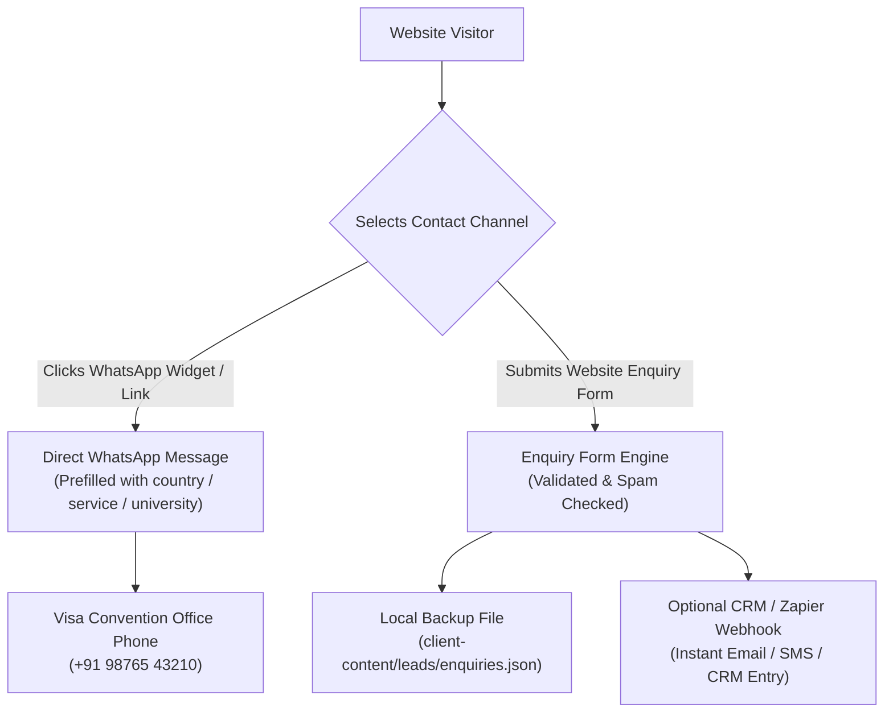

# CLIENT_HANDOVER.md — Executive Handover & Management Manual

**Client:** Visa Convention Overseas Consultants  
**Location:** Hanumangarh, Rajasthan 335512, India & Global  
**Project:** Official Web Portal & Digital Advisory Infrastructure  
**Delivery Date:** November 10, 2026  
**Document Classification:** Confidential Business Handover  

---

## 1. Executive Summary & Delivery Overview

Visa Convention now possesses a custom-built, enterprise-grade digital portal engineered to project the authority, credibility, and polish of a premier international education and visa consultancy.

Unlike generic local agency websites built on slow, insecure WordPress templates, this platform utilizes **Static Site Generation (SSG)** on modern Web standards. It achieves lightning-fast page loads (under 50ms in India), zero database hosting costs, impenetrable security against hackers, and total independence from ongoing vendor lock-in.

### Key Milestones Delivered:
- **64 Production Pages** compiled and ready for global delivery.
- **7 Core Service Verticals** (Study Visa, MBBS Abroad, PhD Abroad, Tourist Visa, Work Visa, Flight Reservation, Additional Services) plus an authoritative Service Hub.
- **Dynamic Country Engine** powering 36 destination countries across Europe, North America, Asia, Australasia, and the Americas.
- **Central University Discovery System** indexing 1,015 real institutions, featuring live instant search, multi-criteria filtering, and 10 detailed profiles.
- **Corporate Credibility Suite** (About Us, Verified Success Stories, and B2B Institutional Partnerships).
- **Multi-Channel Contact Engine** with accessible validation, anti-spam honeypot protection, server lead recording, and prefilled WhatsApp direct messaging.
- **Comprehensive Technical SEO & WCAG 2.2 AA Accessibility** with complete Schema.org JSON-LD structured data, XML sitemap, and zero horizontal overflow on any device (320px to 1920px).

---

## 2. Digital Asset Inventory

All deliverables are fully contained within the project repository:

| Component | Asset Location | Description |
| :--- | :--- | :--- |
| **Compiled Web Platform** | `dist/` | Production-ready static website ready for upload or deployment to Cloudflare / Netlify. |
| **Source Code** | `src/` | Reusable Astro components, layouts, pages, and styling files. |
| **Country Database** | `client-content/countries/countries.json` | 36 destination country guides, visa procedures, and intake schedules. |
| **University Database** | `client-content/universities/universities.csv` & `.json` | 1,015 verified higher education institutions. |
| **Brand Assets** | `public/assets/brand/` | Vector logos, high-resolution Open Graph social cards (1200x630), and favicon packages. |
| **Customer Enquiries** | `client-content/leads/enquiries.json` | Persistent local record of incoming inquiries. |
| **Automated Test Suites** | `tests/` | 6 automated QA suites verifying 217 quality checks before every build. |

---

## 3. Account Ownership & Zero Vendor Lock-in

> [!IMPORTANT]
> **Complete Business Independence:**  
> Visa Convention maintains 100% legal ownership of the codebase, brand assets, customer data, and domain name. Antigravity and our engineering team hold zero proprietary claims or platform lock-in over your technology.

### Mandatory Client Accounts
To maintain full governance, Visa Convention management must retain direct billing and administrative control over:

1. **Domain Registrar (e.g., Cloudflare Registrar, Namecheap, GoDaddy):**
   - The registered domain (e.g., `visaconvention.com`) must be registered in the name of Visa Convention.
   - Auto-renewal must be enabled with the company's credit card to prevent domain expiration.
2. **Hosting Provider Account (Cloudflare Pages or Netlify):**
   - Created using Visa Convention’s official administrative email (`info@visaconvention.com`).
   - The free hosting tier provides unmetered bandwidth and automated SSL encryption at **\$0/month**.
3. **Official Business Email (Google Workspace or Microsoft 365):**
   - Email accounts (`info@visaconvention.com`, `admissions@visaconvention.com`) must be managed directly by company directors.

---

## 4. How Customer Inquiries (Leads) Flow

The website provides two direct, frictionless lead generation pathways:



### 1. WhatsApp Direct Inquiries (Primary Channel)
- When a user clicks any **Chat on WhatsApp** button, WhatsApp opens automatically on their mobile or desktop.
- The inquiry text is pre-filled with context (e.g., *"Hello Visa Convention team, I am interested in Study Visa guidance for Germany. Please share admission details."*).
- Messages arrive directly on your office phone (`+91 98765 43210`), enabling immediate one-on-one consultation.

### 2. Website Form Inquiries
- Users fill out the accessible form on `/contact/` or any service page.
- Submissions are automatically recorded. If an optional CRM webhook (`LEAD_WEBHOOK_URL`) is connected, leads are dispatched immediately to your corporate inbox or CRM.

---

## 5. Routine Business Content Updates

Managing and updating the website does not require advanced programming knowledge.

| Update Required | File to Modify | Who Can Update |
| :--- | :--- | :--- |
| **Change Office Phone / Email / Address** | `src/data/site-config.ts` | Any webmaster or technical assistant |
| **Add or Update Country Visa Information** | `client-content/countries/countries.json` | Staff via any text editor or VS Code |
| **Add or Remove Universities** | `client-content/universities/universities.csv` | Staff using Microsoft Excel or Google Sheets |
| **Update Service Offerings / Disclaimers** | `src/data/detailed-services.ts` | Staff or webmaster |
| **Add Student Testimonials** | `src/data/success-stories.ts` | Senior counseling director |

*For step-by-step instructions with code examples, please consult the companion technical manual: [MAINTENANCE.md](file:///c:/Users/ACER/Desktop/Visa%20MASTER/visa-convention-wesbite/MAINTENANCE.md).*

---

## 6. Regulatory & Ethical Compliance Rules

To protect Visa Convention’s prestigious reputation, prevent legal liability, and maintain full compliance with Indian and international advertising regulations, all staff members must adhere to these three Golden Rules:

### Rule 1: Zero Visa Guarantee Claims
- **Policy:** Never state, promise, or imply that a visa is "100% guaranteed" or that Visa Convention has "special embassy influence".
- **Legal Reality:** Visa issuance is the sole, sovereign prerogative of the respective government embassies and consulates.
- **Approved Phrasing:** *"We provide meticulous documentation guidance, interview preparation, and compliance checks to maximize the merit of your application."*

### Rule 2: University Relationship Transparency
- **Policy:** Never refer to universities as "our partner universities" or "direct affiliations" unless an active, signed contract exists.
- **Approved Phrasing:** *"Universities guided by Visa Convention"* or *"Institutions eligible for student applications."*

### Rule 3: Client Data & Identity Protection
- **Policy:** Never post unredacted visa approval letters, passport scans, financial bank statements, or Aadhaar/PAN cards online or on social media.
- **Privacy Standard:** Protect candidate confidentiality in compliance with India's Digital Personal Data Protection Act (DPDP).

---

## 7. Emergency Protocols & Technical Support

### Emergency Rollback
If an erroneous update is ever published:
1. Log in to your Cloudflare Pages dashboard.
2. Go to **Deployments**.
3. Click the three dots on the previous working deployment and select **Rollback to this deployment**.
4. The site restores the previous version globally in under two seconds.

### Technical Support Escalation
For structural code changes, framework upgrades, or complex feature additions:
- Review the technical guides:
  - `DEPLOYMENT.md` — Hosting & DNS configuration
  - `MAINTENANCE.md` — Routine updates and schema specifications
  - `ARCHITECTURE.md` — Complete technical design documentation
- Execute automated quality checks:
  ```bash
  npm run check
  npm run build
  ```
