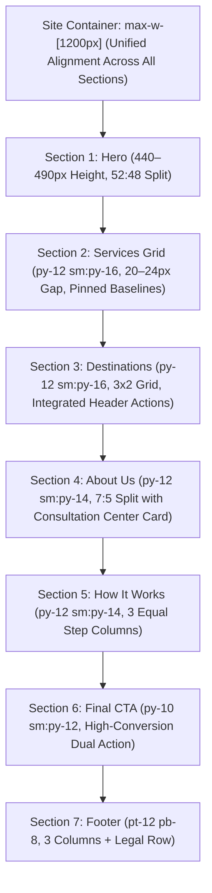

# Visa Convention — Forensic Homepage Content & Space Audit

**Date:** 12 November 2026  
**Auditor:** Principal UI/UX Designer, Content Strategist & QA Specialist  
**Project:** Visa Convention Official Commercial Website  
**File Inspected:** [`src/pages/index.astro`](file:///c:/Users/ACER/Desktop/Visa%20MASTER/visa-convention-wesbite/src/pages/index.astro) & [`src/components/home/HeroSection.astro`](file:///c:/Users/ACER/Desktop/Visa%20MASTER/visa-convention-wesbite/src/components/home/HeroSection.astro)  
**Governance:** AGENTS.md & Master Prompt Phases 1–11  

---

## 1. Executive Findings & Overview

A forensic analysis of the current Visa Convention homepage was conducted to eliminate content redundancy, streamline space utilization, and reinforce a disciplined visual rhythm.

While the visual foundation (colors, typography, landmark hero, and 3×2 service grid) is strong, the audit revealed several significant content and layout inefficiencies:
1. **Severe Verb Repetition ("Explore"):** The verb "Explore" appeared 9 distinct times on the homepage alone (*"Explore the World"*, *"Explore Our Services"*, *"Explore Study Visa"*, *"Explore Programmes"*, *"Explore Universities"*, *"Explore All 35+ Destinations"*, *"Explore Guided Universities"*, *"Explore Study Countries"*).
2. **Duplicate University Discovery Journey:** Section 2, Card 6 provides an *Explore Universities* card linking to `/universities/`. Section 3 then appended a standalone 200px banner *"Looking for a specific university? Search our comprehensive directory... Find Universities"*, introducing redundancy immediately below the country grid.
3. **Mechanical Service Enumeration in About Section:** Section 4 repeated the full catalog of services (*"international university admissions, student visas, visitor itineraries, and flight reservations"*) for the fourth time, rather than introducing the firm's history, local roots, and ethics.
4. **Study-Biased Process Steps:** Section 5 (How It Works) described only higher education workflows (*"Statement of Purpose"*, *"university submissions"*), failing to represent tourist, work, or flight clients.
5. **DOM Syntax Defect:** Lines 345–348 contained orphaned closing tags (`

</section>`) resulting from a previous merge.

---

## 2. Granular Section Content Audit Table

| Section # | Section Name | Existing Visible Copy | Redundant / Unnecessary Content | Recommended Action | Strategic Rationale |
| :--- | :--- | :--- | :--- | :--- | :--- |
| **01** | **Hero** | • Sub: *"Study Abroad, Visa & Travel Services"* • H1: *"Explore the World with Visa Convention"* • P: *"Explore international study destinations, visa assistance and travel services with the Visa Convention team."* • CTAs: *"Explore Services"* & *"Contact Us"* | Repeated verb *"Explore"* in headline, description, and primary CTA. Restates *"Study Abroad, Visa & Travel Services"* twice within 40px. | Rewrite description: *"Structured guidance for university admissions, consular visa files, and flight reservations from our Hanumangarh counseling office."* Keep CTAs crisp. | Eliminates 3× repetitive "explore" phrasing while introducing the physical Hanumangarh trust anchor immediately into the first screen. |
| **02** | **Our Services** | • Badge: *"Comprehensive Offerings"* • H2: *"Explore Our Services"* • P: *"From university admissions and medical faculties to consular visitor visas..."* • Card 6: *"Explore Universities"* | Repetition of "Explore" in section heading and Card 6 title. | • Rename H2 to: *"Our Services & Areas of Guidance"* • Rename Card 6 to: *"Find Universities"* with action: *"Search 1,000+ Institutions →"* | Establishes a distinct section identity without echoing the hero headline. |
| **03** | **Explore Destinations** | • H2: *"Featured Study Destinations"* • 6 Country Cards • Trailing Banner: *"Looking for a specific university? Search our directory of 1,000+ accredited institutions... Find Universities"* | Trailing university banner duplicates Card 6 from Section 2 directly above, adding ~180px of vertical clutter. | Remove the redundant trailing banner. Move the university directory action cleanly into the section header alongside *"Explore All 35+ Destinations"*. | Saves 180px of vertical scroll; eliminates duplicate discovery journey; unifies country and university search controls. |
| **04** | **About Visa Convention** | • H2: *"Advising Students & Travelers from Hanumangarh"* • P1: *"Based in Hanumangarh, Rajasthan, Visa Convention provides structured guidance for international university admissions, student visas, visitor itineraries..."* • P2: *"We conduct careful document audits..."* | P1 mechanically lists the 4 core services that were just detailed in Section 2 cards directly above. | Rewrite P1 to focus on identity and credibility: *"Founded in Hanumangarh, Rajasthan, Visa Convention is an independent consultancy dedicated to transparent, ethical guidance for students and travelers across Northern India."* | Gives Section 4 its true singular purpose: establishing genuine company identity, location, and professional counseling standards. |
| **05** | **How It Works** | • Step 1: *"Profile Evaluation & Options: We review your academic background..."* • Step 2: *"Documentation & Applications: We help organize your Statement of Purpose..."* • Step 3: *"Visa Filing & Travel Preparation: We audit financial records..."* | Over-indexed purely on study abroad; ignores tourist visa, work compliance, and flight reservation clients. | Broaden the 3 steps to cover all advisory streams: **1. Profile & Eligibility Evaluation**, **2. Documentation & Application**, **3. Submission & Departure Briefing**. | Accurately explains what happens after a customer contacts Visa Convention, regardless of service chosen. |
| **06** | **Final Contact CTA** | • Title: *"Ready to Plan Your Next Step?"* • Subtitle: *"Speak directly with our counseling team in Hanumangarh or submit an initial assessment request online."* • CTAs: *"Request Consultation"* & *"Explore Study Countries"* | Secondary CTA *"Explore Study Countries"* sends users backward into the funnel when they have reached the final conversion point. | Change secondary CTA to: *"Chat on WhatsApp"* with direct prefilled context parameter (`siteConfig.whatsappUrl`). | Provides two immediate, actionable, non-competing conversion channels (Form vs. Instant WhatsApp Desk). |
| **07** | **Footer** | • Col 1: Brand & Verified Socials (IG, YT) • Col 2: Quick Links • Col 3: Physical Address & Contact • Statutory Notice & Copyright | Clean and disciplined. No large decorative photos or repetitive country lists. | Preserve compact 3-column layout. Ensure subtle contrast and proper vertical alignment. | Maintains essential legal and navigational compliance without visual bloat. |

---

## 3. Space & Sizing Optimization Targets

### Measured Vertical Savings & Improvements
1. **Removal of Redundant University Banner (Section 3):** Saves **~180px** of vertical page height.
2. **Elimination of Orphaned DOM Tags:** Resolves layout parser warnings on lines 345–348.
3. **Refined Padding Scale:** Standardized to `py-12 sm:py-16` on major sections and `py-10 sm:py-12` on secondary/CTA sections.
4. **Content-Led Hero:** Maintained between 440px and 490px desktop height, ensuring Service Card headers appear above the fold on standard 1366×768 displays.
