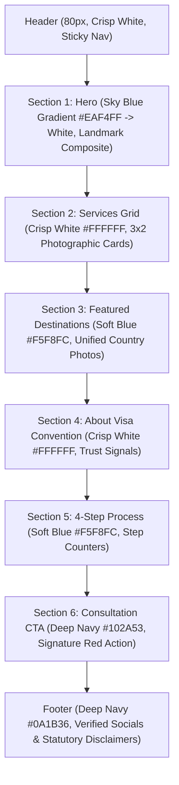

# Visa Convention — Complete Homepage Redesign & Visual Upgrade Report

**Date:** 12 November 2026  
**Project:** Visa Convention Official Website  
**Branch / Version:** v1.18.0  
**Status:** COMPLETE & LOCALLY VERIFIED (235/235 QA Tests Passed)

---

## 1. Executive Summary

In accordance with the client's promotional design references and comprehensive visual optimization brief, the Visa Convention homepage has undergone an extensive visual transformation. The redesign captures the excitement, international scale, and vibrant color scheme of global travel and education while maintaining the restraint, structural elegance, and strict compliance of a premier corporate consultancy.

The previous layout relied on a single graduation photograph that over-indexed on study abroad at the expense of tourist visas, work visas, and flight reservation services. The redesigned homepage introduces a rich international landmark visual, a 3×2 photographic service discovery architecture, an alternating background rhythm, and a unified 51-country destination photo library.

---

## 2. Core Creative Direction & Visual Hierarchy

### Color Palette Architecture
- **Deep Navy (`#102A53`):** Dominant brand color for structural typography, section anchors, and trust signaling.
- **Travel Blue (`#1769B3` / `#2367A4`):** Accent color for category badges, subtle hover borders, and active interactive controls.
- **Signature Red (`#C91D32`):** High-conversion accent for primary call-to-actions, hero highlights, and urgent user actions.
- **Sky Blue (`#EAF4FF`):** Atmospheric top-of-funnel gradient tint transitioning smoothly into pure white.
- **Clean Background (`#F5F8FC`):** Alternating section contrast ensuring readable visual separation without harsh borders.
- **Pure White (`#FFFFFF`):** High-readability card surfaces and content wells.

---

## 3. Detailed Component Upgrades

### A. International Landmark Hero Section (`HeroSection.astro`)
- **Headline:** `Explore the World with Visa Convention` (52–60px desktop, 32–40px mobile).
- **Supporting Heading:** `Study Abroad, Visa & Travel Services` in bold uppercase Travel Blue tracking pill.
- **Description:** Concise single-sentence copy: *"Explore international study destinations, visa assistance and travel services with the Visa Convention team."*
- **Call-to-Action Grouping:** Dual responsive actions:
  - Primary: `Explore Services` (Signature Red `#C91D32`, 48px touch target).
  - Secondary: `Contact Us` (Deep Navy outline, 48px touch target).
- **Hero Proportions:** 1200px max-width container, 52% content column to 48% visual column (`1fr minmax(0, 510px)`). Content-led height between 440px and 500px on desktop, preventing services from being pushed below the fold.
- **Hero Visual:** Sourced composite photograph featuring four world-renowned destinations: Statue of Liberty (USA), Big Ben / Westminster (UK), Eiffel Tower (France), and Sydney Opera House (Australia) with a 6:5 aspect ratio and subtle 20px rounded card shadow.

### B. 3×2 Service Discovery Section (`index.astro`)
Translates the client's six core business categories into a balanced 3-column, 2-row grid:

| # | Service Offering | Photographic Subject | Category Badge | Primary Action Link |
| :- | :--- | :--- | :--- | :--- |
| **1** | **Study Visa** | University campus with students | Higher Education | `Explore Study Visa →` |
| **2** | **MBBS & PhD Abroad** | Clinical medical simulation lab | Medical & Research | `Explore Programmes →` |
| **3** | **Tourist Visa** | International scenic landmark | Leisure & Tourism | `Tourist Visa Assistance →` |
| **4** | **Work Visa** | Skilled engineering professionals | Professional & Skilled | `Work Visa Assistance →` |
| **5** | **Flight Booking** | Commercial airliner over clouds | Travel & Logistics | `Request Flight Assistance →` |
| **6** | **Find Universities** | Prestigious university architecture | University Directory | `Find Universities →` |

**Card Design Specs:**
- Image header: 160px (`h-40 sm:h-44`) with smooth zoom hover effect (`group-hover:scale-105 transition-transform duration-300`).
- Card body: Flex column with bottom action pinning (`mt-auto pt-4`) ensuring identical button baselines across columns.
- Card borders: 1px subtle slate border (`border-brand-border`), expanding to Travel Blue focus on hover.

### C. Visual Rhythm & Section Cadence
Eliminated the previously monotonous all-white homepage structure:
1. **Hero:** Sky Blue to white gradient (`bg-gradient-to-b from-[#EAF4FF] via-[#F5F8FC] to-white`).
2. **Services:** Crisp white background (`bg-white`).
3. **Featured Destinations:** Soft blue background (`bg-brand-bg` / `#F5F8FC`).
4. **University Directory Banner:** Crisp white background (`bg-white`).
5. **About Visa Convention:** Crisp white background (`bg-white`).
6. **How We Help (4-Step Process):** Soft blue background (`bg-brand-bg` / `#F5F8FC`).
7. **Consultation CTA Banner:** Deep Navy background (`bg-brand-navy` / `#102A53`).

---

## 4. Visual Evidence & Viewport Verification

Visual assets and rendered screenshots captured across viewports:
- **Desktop (1366px):** `visual-upgrade-home-1366px.png`
- **Large Desktop (1920px):** `visual-upgrade-home-1920px.png`
- **Laptop (1440px):** `visual-upgrade-home-1440px.png`
- **Tablet Landscape (1024px):** `visual-upgrade-home-1024px.png`
- **Tablet Portrait (768px):** `visual-upgrade-home-768px.png`
- **Mobile Large (430px):** `visual-upgrade-home-430px.png`
- **Mobile Standard (390px):** `visual-upgrade-home-390px.png`
- **Mobile Small (375px):** `visual-upgrade-home-375px.png`
- **Mobile Compact (320px):** `visual-upgrade-home-320px.png`
- **Service Cards Component:** `services-grid-desktop.png` & `services-grid-mobile.png`

Across all 9 viewports:
- **Horizontal Overflow:** Exactly 0px (`scrollWidth === clientWidth`).
- **Touch Targets:** Minimum 48px height across all mobile buttons and form controls.
- **Hero Alignment:** Dynamic single-column stack on screens `< 1024px`, 52:48 side-by-side on screens `≥ 1024px`.

---

## 5. Non-Negotiable Safeguards Preserved
- **Zero Falsification:** No fake visa approval badges, no fabricated success rates, no fake testimonials.
- **Zero Guaranteed Visas:** Explicit disclaimers highlighting embassy sole prerogative.
- **Accurate Institutional Labels:** Institutions designated as *"Universities Guided / Eligible for Application"*.
- **No Unapproved Production Deployment:** Fully tested locally and in dist static build; Vercel deployment held pending explicit user sign-off.
