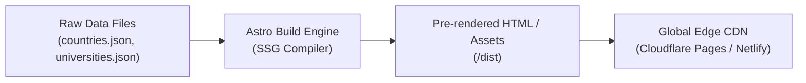

# MAINTENANCE.md — Developer & Operations Maintenance Manual

**Project:** Visa Convention — Official Website  
**Client:** Visa Convention (Hanumangarh, Rajasthan, India & Global)  
**Architecture:** Static Site Generation (Astro 5 + Tailwind CSS v4 + TypeScript)  
**Document Purpose:** Operational guide for routine website updates, data curation, content modification, and security maintenance.

---

## 1. System Architecture & Curation Philosophy

Visa Convention's digital platform is architected around a **static-first, zero-database paradigm**. All business content, destination country records, and university directories reside in typed, human-readable data files (`JSON`, `CSV`, and `TypeScript`).



### Key Maintenance Advantages
- **Instant Deployment:** Edits pushed to the repository automatically build and publish in under 40 seconds.
- **Zero Database Degradation:** No SQL migrations, no database server crashes, and no connection pooling issues.
- **Strict Data Validation:** Schemas enforce data completeness before builds can succeed.

---

## 2. Managing Destination Countries

Destination country data powers the interactive directory at `/study-abroad/` and dynamic country pages at `/study-abroad/[country]/`.

### 2.1 File Location
- **Primary Database:** `client-content/countries/countries.json`
- **Schema Definition:** `client-content/countries/countries-schema.json`
- **TypeScript Interface:** `src/types/index.ts` (`Country` interface)

### 2.2 Adding a New Destination Country
To introduce a new study abroad destination (e.g., *Finland* or *Switzerland*):
1. Open `client-content/countries/countries.json`.
2. Add a new object to the array following the schema:
   ```json
   {
     "id": "finland",
     "name": "Finland",
     "slug": "finland",
     "flagCode": "fi",
     "continent": "Europe",
     "heroImage": "https://images.unsplash.com/photo-1517411032315-54ef2cb783bb?auto=format&fit=crop&w=1920&q=80",
     "shortDescription": "World-renowned education system with English-taught technology and research degrees.",
     "introduction": "Finland offers high-standard university education, cutting-edge innovation hubs, and a serene, safe living environment for international students.",
     "whyStudyHere": [
       "Ranked among the world's most innovative education systems",
       "English-taught bachelor's and master's degree programmes",
       "Post-study work permit opportunities for international graduates"
     ],
     "educationSystem": "Finnish higher education comprises 13 universities and 22 universities of applied sciences (UAS).",
     "studyLevels": ["Bachelor's Degrees", "Master's Degrees", "Doctoral / PhD"],
     "admissionGuidance": "Applications are conducted through the national Studyinfo portal. Requirements include IELTS/TOEFL and certified academic transcripts.",
     "visaGuidance": "International students must obtain a Finnish Residence Permit for Studies through Enter Finland prior to arrival.",
     "costInformation": "Tuition fees range from €8,000 to €18,000 per year for non-EU students. Living costs average €700–€1,000/month.",
     "scholarshipInformation": "Finnish universities offer merit-based tuition waivers covering 50% to 100% of institutional tuition fees.",
     "servicesAvailable": ["Study Visa", "PhD Admissions"],
     "faqs": [
       {
         "question": "Can international students work in Finland while studying?",
         "answer": "Yes. Students holding a valid study residence permit are permitted to work up to 30 hours per week during academic terms."
       }
     ],
     "relatedUniversityIds": [],
     "featured": false,
     "active": true,
     "publicationStatus": "published",
     "sourceLinks": [
       "https://opintopolku.fi/konfo/en/",
       "https://migri.fi/en/residence-permit-for-studies"
     ],
     "lastReviewed": "2026-11-10"
   }
   ```
3. Run verification test:
   ```bash
   node tests/country-engine.test.js
   ```

### 2.3 Updating an Existing Country Page
When visa processing fees, minimum financial thresholds, or intake dates change:
1. Locate the country object in `client-content/countries/countries.json`.
2. Update the respective field (e.g., `costInformation`, `visaGuidance`, or `faqs`).
3. Update `"lastReviewed": "YYYY-MM-DD"` to current date.
4. Save and run `npm run check && npm run build`.

---

## 3. Managing Universities & Institutions

Visa Convention maintains a central database of 1,015+ higher education institutions across 36 countries.

### 3.1 Data Architecture: Bare Records vs. Rich Profiles
The system enforces a **Threshold Rule** to protect technical SEO:
- **Bare Directory Records (1,005+ entries):** Listed in the searchable `/universities/` directory with city, country, website, and degree types. Users can initiate an admission inquiry directly from the card. They do **not** generate standalone URLs, preventing thin-content penalties.
- **Curated Rich Profiles (10+ entries):** Institutions with comprehensive verified data (tuition, scholarships, living costs, application deadlines, course breakdown). These render full interactive pages at `/universities/[university]/`.

### 3.2 Adding a University to the Central Database
1. Open `client-content/universities/universities.json` (or `universities.csv`).
2. Add the institutional record:
   ```json
   {
     "id": "helsinki-university",
     "name": "University of Helsinki",
     "slug": "helsinki-university",
     "countryId": "finland",
     "city": "Helsinki",
     "officialWebsite": "https://www.helsinki.fi/en",
     "institutionType": "Public Research University",
     "studyLevels": ["Bachelor", "Master", "PhD"],
     "subjectAreas": ["Computer Science", "Biological Sciences", "Humanities"],
     "courses": ["MSc Data Science", "MSc Integrative Plant Sciences"],
     "admissionInformation": "Annual application window closes in January. High school or bachelor's GPA of 70%+ required.",
     "tuitionInformation": "€13,000–€18,000/year for non-EU students.",
     "scholarshipInformation": "Helsinki University Scholarships provide full tuition waivers plus €10,000 living grants for top applicants.",
     "featured": false,
     "relationshipStatus": "eligible_guidance",
     "logoAsset": "",
     "coverImage": "",
     "sourceLinks": ["https://www.helsinki.fi/en/admissions"],
     "lastReviewed": "2026-11-10",
     "publicationStatus": "published"
   }
   ```

### 3.3 Promoting a University to a Full Interactive Profile
To publish a dedicated profile page at `/universities/helsinki-university/`:
1. Open `src/data/universities.ts`.
2. Locate the `DETAILED_PROFILES` array.
3. Add the enriched profile object containing full structural details (`highlights`, `popularCourses`, `entryRequirements`, `counselingSupport`).
4. Save the file.
5. Re-run `npm run build`. The dynamic route generator will automatically compile `/universities/helsinki-university/index.html` and register it in `sitemap.xml`.

> [!WARNING]
> **Relationship Status Rule:**  
> Never set `"relationshipStatus": "official_partner"` unless an active, signed memorandum of understanding exists. For all regular guidance institutions, always use `"eligible_guidance"`.

---

## 4. Modifying Service Verticals

Visa Convention provides 7 core services plus a central Service Overview Hub.

### 4.1 File Locations
- **Service Index & Card Summaries:** `src/data/services.ts`
- **Comprehensive Service Specs & FAQs:** `src/data/detailed-services.ts`
- **Service Page Template:** `src/pages/services/[service].astro`

### 4.2 Updating a Service Vertical
To revise processing timelines, required documents, or regulatory disclaimers:
1. Open `src/data/detailed-services.ts`.
2. Find the target service by key:
   - `'study-visa'`
   - `'mbbs'`
   - `'phd'`
   - `'tourist-visa'`
   - `'work-visa'`
   - `'flight-booking'`
   - `'additional-services'`
3. Modify the relevant arrays (`deliverables`, `eligibilityCriteria`, `processSteps`, or `faqs`).
4. For regulatory disclosures (such as NMC FMGL regulations or Consular Discretion notices), update the `regulatoryDisclaimers` array.
5. Verify build integrity:
   ```bash
   npm run check && npm run build
   ```

---

## 5. Managing Trust, Testimonials & Case Studies

Trust is the core business currency of Visa Convention. Strict governance applies to all public outcome claims.

### 5.1 File Location
- `src/data/success-stories.ts`
- `src/data/about.ts`

### 5.2 Testimonial & Case Study Protocol
Under Section 3 of `AGENTS.md`:
1. **Student Consent Required:** No testimonial may be published without written or verified electronic consent.
2. **Mandatory PII Redaction:** Never display passport numbers, national ID numbers, visa grant notice tracking numbers, or bank account statements.
3. **Factual Verification:** Every case study must reference a legitimate institution listed in our database.
4. **Draft Quarantine:** If a testimonial has not yet been formally verified by management, set `"publicationStatus": "draft"` so it is excluded from public builds.

---

## 6. Updating Office NAP & Contact Information

When business telephone numbers, office hours, or physical addresses change:

### 6.1 Central Site Configuration
- **File:** `src/data/site-config.ts`

```typescript
export const SITE_CONFIG = {
  name: "Visa Convention",
  legalName: "Visa Convention Overseas Consultants",
  telephone: "+91 96803-95539",
  telephoneRaw: "+919680395539",
  whatsappNumber: "+91 96803-95539",
  whatsappNumberRaw: "919680395539",
  email: "visaconvention064@gmail.com",
  admissionsEmail: "visaconvention064@gmail.com",
  officeHours: "Monday – Saturday: 9:30 AM – 6:30 PM IST (Sunday Closed)",
  address: {
    street: "Main Commercial Market / Advisory Hub",
    city: "Hanumangarh",
    state: "Rajasthan",
    postalCode: "335512",
    country: "India",
    geoCoordinates: {
      latitude: 29.5816,
      longitude: 74.3218
    }
  }
};
```
Editing this single file automatically updates:
- Sitewide Header & Footer
- Contact Page NAP banner
- WhatsApp Click-to-Chat widget
- Schema.org `LocalBusiness` JSON-LD structured data
- Open Graph localized metadata

---

## 7. Lead Processing & Webhook Integration

### 7.1 Local & Staging Environment
Enquiry submissions made via `/contact/` or service enquiry forms are dispatched to `src/pages/api/submit-enquiry.ts`. In local development or Node server runtimes, inquiries are appended to:
- `client-content/leads/enquiries.json`

### 7.2 Production CRM / Webhook Forwarding
For production deployments on Cloudflare Pages or Netlify, configure an external CRM or webhook destination (e.g., Zapier, Make, Zoho CRM, or Google Sheets):
1. Create a secure webhook in your CRM.
2. In the Cloudflare Pages dashboard, set the environment variable:
   ```text
   LEAD_WEBHOOK_URL = https://hook.eu2.make.com/your-private-webhook-id
   ```
3. `src/pages/api/submit-enquiry.ts` forwards form payloads to this endpoint securely without exposing credentials to the client browser.

---

## 8. Routine Security & Dependency Maintenance

Antigravity recommends performing routine dependency maintenance every 90 days.

### 8.1 Maintenance Checklist
```bash
# 1. Check for dependency security advisories
npm audit

# 2. Check for outdated packages
npm outdated

# 3. Update non-breaking dependencies
npm update

# 4. Typecheck the entire codebase
npm run check

# 5. Execute all automated test suites
node tests/country-engine.test.js
node tests/university-engine.test.js
node tests/credibility-engine.test.js
node tests/contact-engine.test.js
node tests/seo-a11y-audit.test.js
node tests/e2e-comprehensive-audit.test.js

# 6. Verify production build
npm run build
```

### 8.2 Git Commit Standards
Always use conventional commits when pushing updates:
- `data(countries): add Finland destination and 3 universities`
- `fix(contact): update office hours for winter schedule`
- `content(services): update NMC licensing guidelines for MBBS abroad`
- `sec(deps): update astro and dependencies to latest patch`
