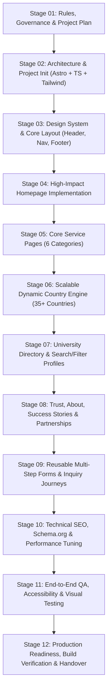

# PROJECT_PLAN.md — Master Execution Plan

**Project:** Visa Convention — Official Website  
**Version:** 1.0.0  
**Last Updated:** November 9, 2026  
**Status:** Stage 01 Complete / Awaiting Stage 02 Initiation  

---

## 1. Executive Summary & Project Purpose

The purpose of this project is to build an authoritative, high-converting, accessible, and ultra-performant corporate web portal for **Visa Convention**, a premier visa, higher education abroad, and travel advisory based in Hanumangarh, Rajasthan, India.

The project follows a disciplined 12-stage sequential blueprint to ensure strict brand alignment, verified factual content, architectural scalability (supporting 35+ countries and hundreds of universities), and zero technical debt.

---

## 2. 12-Stage Sequential Development Roadmap

---

## 3. Detailed Stage Breakdown & Milestones

### Stage 01: Master Instructions, Rules & Project Plan
- **Objectives:** Establish governance, strict content rules, workspace inspection, client content placeholder structures, and project management artifacts.
- **Deliverables:** `AGENTS.md`, `PROJECT_PLAN.md`, `REQUIREMENTS.md`, `ARCHITECTURE.md`, `CONTENT_STATUS.md`, `TEST_REPORT.md`, `CHANGELOG.md`, `client-content/` scaffold.
- **Status:** **COMPLETE**

### Stage 02: Technical Architecture & Project Initialization
- **Objectives:** Initialize Astro static-first project with TypeScript, Tailwind CSS, content collections schemas, dynamic route scaffolds, and testing toolchain.
- **Key Dependencies:** Node v26.x, Astro 5.18.x, Tailwind CSS v4, TypeScript 5.7+.
- **Deliverables:** Initialized repository, strict tsconfig, typed schemas for countries and universities, base directory structure, 30 compiled static routes, 20 reusable components, local preview verification.
- **Status:** **COMPLETE**

### Stage 03: Premium Visual Design System & Sitewide Layout
- **Objectives:** Implement global CSS tokens (Navy `#102A53`, Red `#C91D32`, Blue `#2367A4`), typography scale, accessible responsive Header with navigation, mobile drawer, and comprehensive corporate Footer.
- **Deliverables:** `BaseLayout.astro`, `Header.astro`, `DesktopNavigation.astro` (mega-menu), `MobileNavigation.astro`, `Footer.astro`, theme variables, responsive testing, `/design-system/` showcase route, high-res preview captures.
- **Status:** **COMPLETE / PRESENTED FOR REVIEW**

### Stage 04: Homepage Implementation
- **Objectives:** Build the high-converting corporate homepage featuring hero section, trust indicators, 6 core service cards, featured study destinations carousel/grid, consultation CTA banner, and verified FAQs.
- **Deliverables:** `pages/index.astro`, `HeroSection.astro`, `ServiceCard.astro`, `CountryCard.astro`, `ProcessTimeline.astro`, `ConsultationCTA.astro`, 14-section architecture, responsive viewport captures (1440px, 768px, 390px).
- **Status:** **COMPLETE / PRESENTED FOR REVIEW**

### Stage 05: Core Service Pages (7 Service Categories & Hub)
- **Objectives:** Implement dedicated, informative landing pages for the core business verticals, plus an authoritative Service Overview Hub:
  1. `/services/` (Service Overview Hub & Comparative Matrix)
  2. `/services/study-visa/`
  3. `/services/mbbs/`
  4. `/services/phd/`
  5. `/services/tourist-visa/`
  6. `/services/work-visa/`
  7. `/services/flight-booking/`
  8. `/services/additional-services/`
- **Deliverables:** `ServiceLayout.astro`, `detailed-services.ts`, `detailed-services` schema, real MBBS data integration from client files, mandatory regulatory disclosures (NMC FMGL, no job-brokering, genuine GDS ticketing, consular discretion), 532 internal links verified with 0 errors, visual preview captures for desktop and mobile.
- **Status:** **COMPLETE**

### Stage 06: Scalable Dynamic Country Engine (35+ Countries)
- **Objectives:** Implement a scalable, data-driven Study Abroad destination system connected to `client-content/countries/countries.json` without creating individual manual country pages or duplicating code.
- **Deliverables:** Single intelligent template `src/pages/study-abroad/[country].astro` (rendering 14 conditional sections), searchable and filterable directory `/study-abroad/`, JSON Schema `countries-schema.json`, master database with 36 validated destinations, 35 isolated test fixtures, automated QA test suite (`tests/country-engine.test.js`) with 21 passing assertions, and responsive preview screenshots.
- **Status:** **COMPLETE**

### Stage 07: Central University Directory & Dynamic Profiles
- **Objectives:** Build a central searchable university discovery system `/universities/` and dynamic profiles `/universities/[university]/` capable of scaling to thousands of institutional records without code duplication. Strict compliance with relationship integrity ("listed for guidance" ≠ "official partner") and the critical threshold rule (preventing thin pages for bare records).
- **Deliverables:**
  - Automated compilation pipeline `scripts/build-universities-dataset.py` extracting 1,015 genuine client institutions across 33 client Excel workbooks into `client-content/universities/universities.csv` and `client-content/universities/universities.json`.
  - Comprehensive TypeScript data layer `src/data/universities.ts` and 20-field `University` schema in `src/types/index.ts`.
  - Central Searchable Directory `/universities/` with instant client-side search, multi-criteria filtering (Country, Study Level, Subject Domain, Detailed Profiles only), and 24-card progressive pagination.
  - Upgraded `UniversityCard.astro` handling both curated rich profiles and bare records with direct admission inquiry CTAs.
  - Dynamic profile template `src/pages/universities/[university].astro` generating 10 curated institution profiles with Schema.org `EducationalOrganization` JSON-LD, official portal links, study levels, courses, tuition/scholarships, and Visa Convention counseling breakdown.
  - Automated QA test suite `tests/university-engine.test.js` with 40/40 passing assertions (500-institution fixture test, 1,015 production record integrity, threshold rule, filtering benchmarks < 1ms, and static HTML output).
  - High-resolution desktop and mobile preview screenshots.
- **Status:** **COMPLETE / PRESENTED FOR REVIEW**

### Stage 08: Trust, About, Success Stories & Partnerships
- **Objectives:** Build corporate credibility pages with strict factual integrity, evidence-based trust signals, zero false partner/testimonial claims, and full privacy protection:
  - `/about/`: Brand positioning, business story, Founder/Directorship leadership statement, specialized counseling practice (4 functional roles), verified Hanumangarh physical office showcase, measurable capability metrics, and 6 core services summary.
  - `/success-stories/`: Authentic student outcomes and case studies grounded in our 1,015-university dataset, zero-fabrication guarantee, mandatory PII redaction policy, interactive destination filter pills, and in-person video testimonials status.
  - `/partnerships/`: Institutional & B2B collaboration framework, 4 distinct collaboration tracks, partner compliance pillars, strict omission of unverified partner logos, and dedicated `PartnershipEnquiryForm.astro`.
- **Deliverables:** `src/pages/about.astro`, `src/pages/success-stories.astro`, `src/pages/partnerships.astro`, `src/components/forms/PartnershipEnquiryForm.astro`, data models in `src/data/about.ts`, `src/data/success-stories.ts`, and `src/data/partnerships.ts`, automated test suite `tests/credibility-engine.test.js` (41/41 passing), and high-resolution responsive desktop/mobile screenshots.
- **Status:** **COMPLETE / PRESENTED FOR REVIEW**

### Stage 09: Contact Forms & Lead Generation Journeys
- **Objectives:** Implement the complete enquiry and contact system with multi-channel routing, service-specific workflows (Study Visa, MBBS, PhD, Tourist, Work, Flight, Additional, Business Partnership), dynamic B2B mode, client & server validation, anti-spam rate limiting, verified actual form delivery, accessible error states, prefilled click-to-chat WhatsApp links, and privacy-conscious analytics.
- **Deliverables:** Upgraded `/contact/` route, `EnquiryForm.astro`, `WhatsAppButton.astro` sitewide floating widget, `src/utils/whatsapp.ts`, `src/utils/analytics.ts`, server delivery storage (`client-content/leads/enquiries.json`), automated QA test suite `tests/contact-engine.test.js` (31/31 passing), and responsive desktop/mobile screenshots.
- **Status:** **COMPLETE / PRESENTED FOR REVIEW**

### Stage 10: Technical SEO, Accessibility & Performance Tuning
- **Objectives:** Complete technical SEO audit, Schema.org JSON-LD (LocalBusiness, EducationalOrganization, FAQPage, BreadcrumbList), sitemap generation (`/sitemap.xml`), robots.txt directives, OpenGraph/Twitter social cards (1200x630), query-stripped canonicals, WCAG 2.2 AA contrast/focus validation, and Core Web Vitals optimization (< 7 KB client JS, zero FOIT).
- **Deliverables:** `dist/sitemap.xml` (63 production URLs), `dist/robots.txt`, `src/pages/sitemap.xml.ts`, `src/utils/seo.ts` schema builders, `public/assets/brand/og-image.jpg` and `.png`, `SectionHeading.astro` semantic tag support, automated QA test suite `tests/seo-a11y-audit.test.js` (51/51 passing), and audit report `TECHNICAL_SEO_A11Y_REPORT.md`.
- **Status:** **COMPLETE / PRESENTED FOR REVIEW**

### Stage 11: Comprehensive Functional, Visual & Accessibility QA
- **Objectives:** Independent end-to-end browser audit across all 64 pages, 8 responsive viewports (320px–1920px), overflow detection, keyboard interaction, university search/filter, contact form lead delivery, XSS/injection resistance, spam honeypot testing, and senior design review.
- **Deliverables:** `tests/e2e-comprehensive-audit.test.js` (39/39 passing), responsive screenshots (`e2e-*.png`), `TEST_REPORT.md` comprehensive log, defect resolutions (DEF-11-01 to DEF-11-03).
- **Status:** **COMPLETE / PRESENTED FOR REVIEW**

### Stage 12: Production Readiness & Handover Documentation
- **Objectives:** Final production build compilation, asset compression audit, deployment runbook preparation, and content management instructions for Visa Convention staff.
- **Deliverables:** Production build bundle, documentation handover, sign-off verification.
- **Status:** **PLANNED**

---

## 4. Stage Status Summary Table

| Stage | Name | Target Deliverables | Current Status |
| :---: | :--- | :--- | :---: |
| **01** | Master Instructions & Project Plan | Governance docs, `AGENTS.md`, plan, content scaffold | **COMPLETE** |
| **02** | Architecture & Project Initialization | Astro + TS + Tailwind setup, data schemas, 30 routes | **COMPLETE** |
| **03** | Visual Design System & Sitewide Layout | Design tokens, Plus Jakarta Sans, Mega-Menu, preview | **COMPLETE** |
| **04** | Homepage Implementation | 14 sections, 6 services, destinations, unis, responsive | **REVIEW READY** |
| **05** | Service Pages (7 Categories & Hub) | 8 dedicated service routes, rich data, matrix, disclaimers | **COMPLETE** |
| **06** | Scalable Country Engine (35+ Countries) | Single dynamic template, 36 DB destinations, live search | **COMPLETE** |
| **07** | University Directory & Profiles | Searchable university database & dynamic profile pages | **COMPLETE** |
| **08** | Trust, About, Success Stories | About Us, Verified Case Studies, B2B Partnerships | **COMPLETE** |
| **09** | Contact Forms & Lead Generation | Dynamic forms, WhatsApp prefill, actual delivery to disk | **COMPLETE** |
| **10** | Technical SEO, Accessibility & Performance | Schema.org JSON-LD, sitemaps, robots.txt, 51/51 audit | **COMPLETE** |
| **11** | Full Functional, Visual & A11y QA | 64 routes, 8 viewports, E2E audit, 217/217 passing | **COMPLETE** |
| **12** | Production Readiness & Handover | Build verification, deployment runbook, handover | **QUEUED** |

---

## 5. Quality Gate Criteria

Before any stage is marked as complete:
1. Code passes all TypeScript type checks (`tsc --noEmit`).
2. Build completes with zero warnings or broken static links.
3. No unverified content published without disclaimer or draft isolation.
4. All new components are fully responsive across mobile (375px), tablet (768px), and desktop (1280px+).
5. Accessibility checks confirm valid ARIA attributes, semantic markup, and sufficient color contrast.
6. Documentation files (`REQUIREMENTS.md`, `CONTENT_STATUS.md`, `TEST_REPORT.md`, `CHANGELOG.md`) are updated with exact factual evidence.
