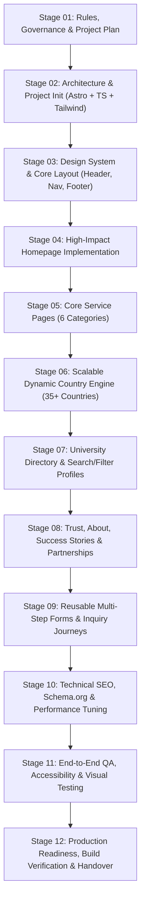

# PROJECT_PLAN.md — Master Execution Plan

**Project:** Visa Convention — Official Website  
**Version:** 1.0.0  
**Last Updated:** November 9, 2026  
**Status:** Stage 01 Complete / Awaiting Stage 02 Initiation  

---

## 1. Executive Summary & Project Purpose

The purpose of this project is to build an authoritative, high-converting, accessible, and ultra-performant corporate web portal for **Visa Convention**, a premier visa, higher education abroad, and travel advisory based in Hanumangarh, Rajasthan, India.

The project follows a disciplined 12-stage sequential blueprint to ensure strict brand alignment, verified factual content, architectural scalability (supporting 35+ countries and hundreds of universities), and zero technical debt.

---

## 2. 12-Stage Sequential Development Roadmap

---

## 3. Detailed Stage Breakdown & Milestones

### Stage 01: Master Instructions, Rules & Project Plan
- **Objectives:** Establish governance, strict content rules, workspace inspection, client content placeholder structures, and project management artifacts.
- **Deliverables:** `AGENTS.md`, `PROJECT_PLAN.md`, `REQUIREMENTS.md`, `ARCHITECTURE.md`, `CONTENT_STATUS.md`, `TEST_REPORT.md`, `CHANGELOG.md`, `client-content/` scaffold.
- **Status:** **COMPLETE**

### Stage 02: Technical Architecture & Project Initialization
- **Objectives:** Initialize Astro static-first project with TypeScript, Tailwind CSS, content collections schemas, dynamic route scaffolds, and testing toolchain.
- **Key Dependencies:** Node v26.x, Astro 5.18.x, Tailwind CSS v4, TypeScript 5.7+.
- **Deliverables:** Initialized repository, strict tsconfig, typed schemas for countries and universities, base directory structure, 30 compiled static routes, 20 reusable components, local preview verification.
- **Status:** **COMPLETE**

### Stage 03: Premium Visual Design System & Sitewide Layout
- **Objectives:** Implement global CSS tokens (Navy `#102A53`, Red `#C91D32`, Blue `#2367A4`), typography scale, accessible responsive Header with navigation, mobile drawer, and comprehensive corporate Footer.
- **Deliverables:** `BaseLayout.astro`, `Header.astro`, `DesktopNavigation.astro`, `MobileNavigation.astro`, `Footer.astro`, theme variables, responsive testing.
- **Status:** **PROPOSED / READY FOR EXECUTION**

### Stage 04: Homepage Implementation
- **Objectives:** Build the high-converting corporate homepage featuring hero section, trust indicators, 6 core service cards, featured study destinations carousel/grid, consultation CTA banner, and verified FAQs.
- **Deliverables:** `pages/index.astro`, `HeroSection.astro`, `ServiceCard.astro`, `CountryCard.astro`, `ProcessTimeline.astro`, `ConsultationCTA.astro`.
- **Status:** **PLANNED**

### Stage 05: Core Service Pages (6 Service Categories)
- **Objectives:** Implement dedicated, informative landing pages for the 6 core business verticals:
  1. `/services/study-visa/`
  2. `/services/mbbs/`
  3. `/services/phd/`
  4. `/services/tourist-visa/`
  5. `/services/work-visa/`
  6. `/services/flight-booking/`
- **Deliverables:** Reusable service layout, step-by-step application guidance, eligibility criteria checklists, disclaimer banners.
- **Status:** **PLANNED**

### Stage 06: Scalable Dynamic Country Engine (35+ Countries)
- **Objectives:** Implement data-driven dynamic country route generator `/study-abroad/[country]/` capable of rendering 35+ countries from structured data without manual template duplication.
- **Deliverables:** Country hub `/study-abroad/`, country template `[country].astro`, schema validation, country flag & hero integration, university listing subset.
- **Status:** **PLANNED**

### Stage 07: Central University Directory & Dynamic Profiles
- **Objectives:** Central searchable university directory `/universities/` with instant client-side filtering by country, degree level, and discipline. Dynamic university profiles `/universities/[university]/`.
- **Deliverables:** `UniversityDirectory.astro`, `UniversitySearch.astro`, `UniversityFilters.astro`, `UniversityCard.astro`, `[university].astro`.
- **Status:** **PLANNED**

### Stage 08: Trust, About, Success Stories & Partnerships
- **Objectives:** Build corporate credibility pages with strict factual integrity.
  - `/about/`: Agency background, mission, values, Hanumangarh office.
  - `/success-stories/`: Verified testimonials and student case studies (or draft state if awaiting content).
  - `/partnerships/`: Business-to-business and educational collaboration framework.
- **Deliverables:** Three core credibility pages, trust metrics component, verified disclaimers.
- **Status:** **PLANNED**

### Stage 09: Contact Forms & Lead Generation Journeys
- **Objectives:** Build accessible, spam-protected inquiry forms for general contact, visa assessments, and flight reservation assistance.
- **Deliverables:** `/contact/`, `EnquiryForm.astro`, honeypot spam traps, accessible form validation, WhatsApp direct connect floating widget.
- **Status:** **PLANNED**

### Stage 10: Technical SEO, Accessibility & Performance Tuning
- **Objectives:** Complete technical SEO audit, Schema.org JSON-LD (LocalBusiness, EducationalOrganization, FAQPage, BreadcrumbList), sitemap generation, OpenGraph/Twitter social cards, Core Web Vitals optimization.
- **Deliverables:** `sitemap-index.xml`, `robots.txt`, JSON-LD components, Lighthouse 95+ score validation.
- **Status:** **PLANNED**

### Stage 11: Comprehensive Functional, Visual & Accessibility QA
- **Objectives:** Cross-browser verification, mobile responsiveness testing across multiple viewports, WCAG 2.1 AA keyboard navigation check, broken link checker.
- **Deliverables:** `TEST_REPORT.md` execution, automated test suite runs, resolution of any UI regressions.
- **Status:** **PLANNED**

### Stage 12: Production Readiness & Handover Documentation
- **Objectives:** Final production build compilation, asset compression audit, deployment runbook preparation, and content management instructions for Visa Convention staff.
- **Deliverables:** Production build bundle, documentation handover, sign-off verification.
- **Status:** **PLANNED**

---

## 4. Stage Status Summary Table

| Stage | Name | Target Deliverables | Current Status |
| :---: | :--- | :--- | :---: |
| **01** | Master Instructions & Project Plan | Governance docs, `AGENTS.md`, plan, content scaffold | **COMPLETE** |
| **02** | Architecture & Project Initialization | Astro + TS + Tailwind setup, data schemas, 30 routes | **COMPLETE** |
| **03** | Visual Design System & Sitewide Layout | Design tokens, Header, Footer, Nav components | **READY FOR EXECUTION** |
| **04** | Homepage Implementation | High-conversion corporate homepage | **QUEUED** |
| **05** | Service Pages (6 Core Services) | 6 dedicated service routes & structured guidance | **QUEUED** |
| **06** | Scalable Country Engine (35+ Countries) | Data-driven dynamic country routing & templates | **QUEUED** |
| **07** | University Directory & Profiles | Searchable university database & dynamic profile pages | **QUEUED** |
| **08** | About, Trust, Stories & Partnerships | Corporate credibility and verified background pages | **QUEUED** |
| **09** | Contact Forms & Inquiry Journeys | Multi-channel contact and validated inquiry forms | **QUEUED** |
| **10** | Technical SEO & Performance Tuning | Schema.org, sitemap, OpenGraph, Web Vitals 95+ | **QUEUED** |
| **11** | Full Functional, Visual & A11y QA | Cross-browser, responsive, WCAG 2.1 AA audit | **QUEUED** |
| **12** | Production Readiness & Handover | Build verification, deployment runbook, handover | **QUEUED** |

---

## 5. Quality Gate Criteria

Before any stage is marked as complete:
1. Code passes all TypeScript type checks (`tsc --noEmit`).
2. Build completes with zero warnings or broken static links.
3. No unverified content published without disclaimer or draft isolation.
4. All new components are fully responsive across mobile (375px), tablet (768px), and desktop (1280px+).
5. Accessibility checks confirm valid ARIA attributes, semantic markup, and sufficient color contrast.
6. Documentation files (`REQUIREMENTS.md`, `CONTENT_STATUS.md`, `TEST_REPORT.md`, `CHANGELOG.md`) are updated with exact factual evidence.
