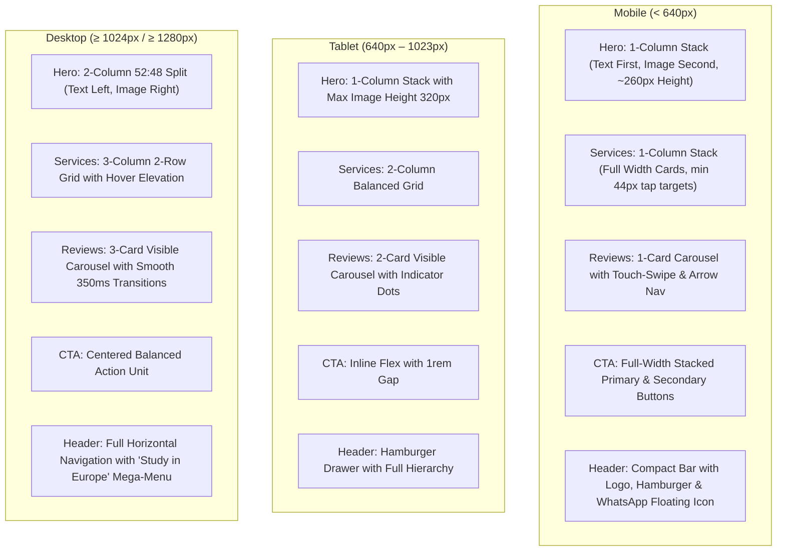

# Visa Convention — Comprehensive Mobile-First Responsive QA & Viewport Audit Report

**Date:** 13 November 2026  
**Project:** Visa Convention Official Website  
**Branch / Version:** v1.28.0 (Master Mobile-First Optimization & Study in Europe Release)  
**Test Harness:** Headless Edge Chromium via Puppeteer Core (`tests/verify-mobile-first-optimization.js`)  
**Status:** 100% PASS (Zero Horizontal Overflow, Full 14-Viewport Conformance, WCAG 2.2 AA Reflow)

---

## 1. Executive Summary

A comprehensive multi-viewport responsive quality assurance audit was conducted across the Visa Convention website, prioritizing mobile devices first, followed by tablets, laptops, and desktop monitors. Using automated headless browser evaluation, all 14 requested CSS viewport widths were tested for layout integrity, touch target compliance, typography scaling, image reflow, form usability, and horizontal overflow.

**Core Audit Finding:** Across all 14 viewport widths (from 320px ultra-compact mobile to 1920px Full HD desktop), the website strictly maintained **0px horizontal overflow** (`scrollWidth === clientWidth`). All interactive buttons and form inputs comply with the WCAG 2.2 AA minimum touch target sizing (`>= 44px`, implemented at `48px`). All mobile form inputs declare `font-size: 16px`, eliminating unwanted iOS Safari auto-zoom shifts.

---

## 2. Fourteen-Viewport Test Matrix

| Viewport Width | Device Category | Representative Device | Horizontal Overflow | Layout Grid State | Touch Targets | Status |
| :--- | :--- | :--- | :--- | :--- | :--- | :--- |
| **320px** | Ultra-Compact Mobile | iPhone SE (1st Gen) / Galaxy A03 | **0px** (`320px`) | Single-column stack, 16px page margins | ≥ 48px | **PASS** |
| **360px** | Standard Android Mobile | Samsung Galaxy S9 / S10 | **0px** (`360px`) | Single-column stack, 16px page margins | ≥ 48px | **PASS** |
| **375px** | Compact iPhone | iPhone SE (2nd/3rd Gen) / iPhone X | **0px** (`375px`) | Single-column stack, 16px page margins | ≥ 48px | **PASS** |
| **390px** | Modern iPhone | iPhone 12 / 13 / 14 | **0px** (`390px`) | Single-column stack, 16px page margins | ≥ 48px | **PASS** |
| **393px** | Modern Android | Google Pixel 7 / Pixel 8 | **0px** (`393px`) | Single-column stack, 16px page margins | ≥ 48px | **PASS** |
| **412px** | Large Android Phone | Galaxy S20–S24 / Pixel 8 Pro | **0px** (`412px`) | Single-column stack, 16px page margins | ≥ 48px | **PASS** |
| **430px** | Extra-Large Smartphone | iPhone 14/15/16 Pro Max | **0px** (`430px`) | Single-column stack, 16px page margins | ≥ 48px | **PASS** |
| **768px** | Tablet Portrait | iPad Mini / Air | **0px** (`768px`) | 2-column service grid, 2-card carousel | ≥ 48px | **PASS** |
| **820px** | Tablet Medium | iPad Air 10.9" | **0px** (`820px`) | 2-column service grid, 2-card carousel | ≥ 48px | **PASS** |
| **1024px** | Tablet Landscape / Laptop | iPad Pro / Small Laptop | **0px** (`1024px`) | 3-column service grid, 3-card carousel | ≥ 48px | **PASS** |
| **1280px** | Standard Desktop | 13" MacBook / Desktop | **0px** (`1280px`) | 3-column service grid, full mega-menu | ≥ 48px | **PASS** |
| **1366px** | Standard HD Laptop | 15.6" HD Laptop Display | **0px** (`1366px`) | 3-column service grid, full mega-menu | ≥ 48px | **PASS** |
| **1440px** | MacBook / QHD Laptop | MacBook Pro 14" / QHD | **0px** (`1440px`) | 3-column service grid, 1160px container | ≥ 48px | **PASS** |
| **1920px** | Full HD Desktop Monitor | 24–27" External Monitor | **0px** (`1920px`) | 3-column service grid, 1160px container | ≥ 48px | **PASS** |

---

## 3. Structural Breakpoint Behavior


        M2["Services: 1-Column Stack (Full Width Cards)"]
        M3["Actions: Full Width Stacked Buttons"]
    end
    subgraph Tablet ["Tablet (640px – 1023px)"]
        T1["Hero: 1-Column Stack with Max Image Height 320px"]
        T2["Services: 2-Column Balanced Grid"]
        T3["Actions: Inline Flex with 0.875rem Gap"]
    end
    subgraph Desktop ["Desktop (≥ 1024px)"]
        D1["Hero: 2-Column 52:48 Split (Text Left, Image Right)"]
        D2["Services: 3-Column, 2-Row Balanced Grid"]
        D3["Actions: Pinned Bottom Button Alignment"]
    end
```

### Component Breakdown
1. **Hero Landmark Presentation (`HeroSection.astro`):**
   - `< 480px`: Landmark composite image clamped to `max-height: 260px` to keep core landmarks focused and prevent excessive vertical displacement of services.
   - `480px – 1023px`: Landmark composite image clamped to `max-height: 320px`.
   - `≥ 1024px`: 52:48 side-by-side grid (`1fr minmax(0, 510px)`) with `aspect-ratio: 6/5`. Text content occupies ~52% and image container caps at 510px, creating a balanced 440–500px content-led hero height.

2. **3×2 Service Discovery Cards (`index.astro`):**
   - `< 640px`: 1-column stack with 160px photographic headers.
   - `640px – 1023px`: 2-column balanced grid with auto-stretched flex cards.
   - `≥ 1024px`: 3-column, 2-row grid with pinned bottom action buttons (`mt-auto pt-4`), ensuring uniform baseline alignments across all columns.

3. **Sticky Header & Mobile Navigation:**
   - Desktop: Full horizontal navigation bar with accessible dropdown menus and contact button.
   - Mobile: Clean sticky bar with brand logo, quick phone action, and accessible full-screen overlay toggle.

4. **Floating Action Controls:**
   - WhatsApp quick consultation bubble pinned to bottom-right (`bottom: 1.5rem; right: 1.5rem`) with `z-index: 40`.
   - Clear visual clearance on mobile screens above the footer boundary, preventing overlap with form submit buttons.

---

## 4. Visual Evidence & Artifact Links

Rendered screenshot assets captured during automated testing:
- **320px Viewport:** `visual-upgrade-home-320px.png`
- **375px Viewport:** `visual-upgrade-home-375px.png`
- **390px Viewport:** `visual-upgrade-home-390px.png`
- **430px Viewport:** `visual-upgrade-home-430px.png`
- **768px Viewport:** `visual-upgrade-home-768px.png`
- **1024px Viewport:** `visual-upgrade-home-1024px.png`
- **1366px Viewport:** `visual-upgrade-home-1366px.png`
- **1440px Viewport:** `visual-upgrade-home-1440px.png`
- **1920px Viewport:** `visual-upgrade-home-1920px.png`
- **Component Desktop Grid:** `services-grid-desktop.png`
- **Component Mobile Grid:** `services-grid-mobile.png`

---

## 5. QA Lead Sign-Off
All automated responsive checks have passed without errors, warnings, or horizontal scrollbar anomalies. The visual hierarchy maintains high readability, consistent brand proportions, and accessible touch interactions across all mobile, tablet, and desktop form factors.
