# UX Redesign Specification & Information Architecture Plan

**Project:** Visa Convention — Official Website  
**Role:** Principal UX Designer, Information Architect, Accessibility Specialist, Conversion Optimization Expert & Senior Frontend Engineer  
**Status:** PROPOSED & READY FOR IMPLEMENTATION  

---

## 1. Executive Summary & Design Mission

The objective of this redesign is to transition Visa Convention from an extensive, information-dense catalog into a **high-converting, trust-anchored advisory portal**.

The experience is re-engineered around the **5-15-30 Rule of Visitor Intent**:
- **5 Seconds (Understand):** Understand what Visa Convention is, where it is based (Hanumangarh, Rajasthan), and what core services it provides.
- **15 Seconds (Find):** Instantly select between Study Abroad, Visa Assistance, and Flight Bookings without wading through complex academic jargon.
- **30 Seconds (Act):** Take a confident next step (explore filtered universities, review factual requirements, or contact an advisor with context preserved).

---

## 2. Page Inventory & UX Defect Analysis (With Baseline Evidence)

We conducted an end-to-end audit across all 64 compiled production pages, cross-referencing user flow, screen real estate, accessibility, and cognitive load.

| Page / Route | Primary Intent | Baseline UX Defect / Friction Point | Severity | Redesign Solution |
| :--- | :--- | :--- | :---: | :--- |
| **Global Header** (`/`) | Navigation & Orienting | 8 top-level menu items cause visual clutter, cognitive overload, and line wrapping on mid-size screens (1024px–1280px). | **P0** | Consolidate into 5 intent-driven groups: *Study Abroad*, *Visa Services*, *Flight Booking*, *About*, and *Contact*. |
| **Homepage Hero** (`/`) | Value Proposition & Direction | Slogan ("Your Global Journey Begins with Confidence") is generic; lacks immediate action pathways for different visitor types (students vs tourists vs flight seekers). | **P0** | Direct, plain-language proposition: *"Study Abroad, Visa & Travel Assistance — Made Clear."* Add 3 immediate service pathways right below hero copy. |
| **Homepage Body** (`/`) | Discovery & Trust Building | 14 sections create an overly long scroll depth (> 4,500px); repetitive marketing copy dilutes key trust signals. | **P0** | Consolidate to 8 focused sections: Hero, Why Visa Convention (Trust), Destinations, 3-Step Process, University Search Preview, Credentials, FAQs, and Contact CTA. |
| **Country Directory** (`/study-abroad/`) | Destination Selection | 36 countries displayed in a single long grid; lacked instant university exploration link. | **P1** | Alphabetical sorting, continent filter pills, country search, and direct filtered university links (`/universities/?country=[slug]`). |
| **Country Pages** (`/study-abroad/[country]/`) | Destination Evaluation | Dense introductory text precedes actionable academic data; university link was not pre-filtering the central directory. | **P1** | Add "At a Glance" key metrics bar, progressive disclosure for visa/costs, and pre-filtered university directory button. |
| **University Directory** (`/universities/`) | Academic Discovery (1,000+ records) | Long filter sidebar pushes mobile content down; lacks active filter tags; back-navigation could reset user context. | **P0** | Instant URL parameter parsing (`?country=...`), active filter chips with 1-click removal, collapsible mobile filter modal, and pre-filled enquiry actions. |
| **Service Pages** (`/services/[slug]/`) | Service Evaluation | Long formal paragraphs with repeated generic benefits; competing contact options. | **P1** | Unified service layout with structured "Key Highlights", "Step-by-Step Procedure", "Required Documents", and 1 primary context-aware enquiry form. |
| **Enquiry & Contact** (`/contact/`) | Lead Conversion | Arriving from university/country pages required re-selecting or typing context; potential abandonment. | **P0** | Complete context preservation (pre-populating Service, Country, and University name) with visual "Enquiring about..." confirmation banner. |

---

## 3. Revised Sitemap & Global Navigation

```mermaid
flowchart TD
    Header["Global Header (Sticky, WCAG AA)"]
    
    Header --> Nav1["1. Study Abroad ▾"]
    Header --> Nav2["2. Visa Services ▾"]
    Header --> Nav3["3. Flight Booking"]
    Header --> Nav4["4. About ▾"]
    Header --> Nav5["5. Contact (CTA)"]

    Nav1 --> N1A["Explore 35+ Countries (/study-abroad/)"]
    Nav1 --> N1B["Find Universities (/universities/)"]
    Nav1 --> N1C["Study Visa Assistance (/services/study-visa/)"]
    Nav1 --> N1D["MBBS Abroad (/services/mbbs/)"]
    Nav1 --> N1E["PhD Research (/services/phd/)"]

    Nav2 --> N2A["Tourist & Visitor Visa (/services/tourist-visa/)"]
    Nav2 --> N2B["Work Visa Facilitation (/services/work-visa/)"]
    Nav2 --> N2C["Additional Services (/services/additional-services/)"]

    Nav3 --> N3A["Airline Tickets & GDS Holds (/services/flight-booking/)"]

    Nav4 --> N4A["About Visa Convention (/about/)"]
    Nav4 --> N4B["Verified Outcomes (/success-stories/)"]
    Nav4 --> N4C["Institutional Partnerships (/partnerships/)"]

    Nav5 --> N5A["Office Address, Phone, WhatsApp & Form (/contact/)"]
```

---

## 4. Prioritized Implementation Plan

- **Phase 1: Global Navigation Overhaul** (`site-config.ts`, `DesktopNavigation.astro`, `MobileNavigation.astro`).
- **Phase 2: Homepage Hero & Layout Streamlining** (`HeroSection.astro`, `index.astro`).
- **Phase 3: University Directory Usability** (`universities/index.astro`, `UniversityCard.astro`, `UniversityFilters.astro`).
- **Phase 4: Country Pages & Destinations** (`study-abroad/[country].astro`, `study-abroad/index.astro`).
- **Phase 5: Enquiry Form & Context Preservation** (`EnquiryForm.astro`, `contact.astro`).
- **Phase 6: Automated Regression Testing & Before/After Verification**.
